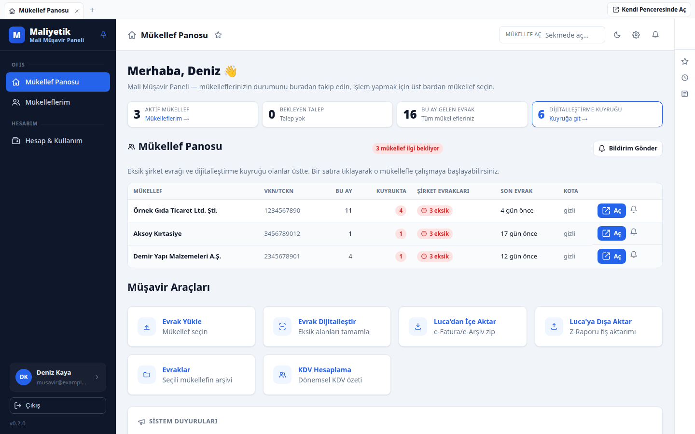
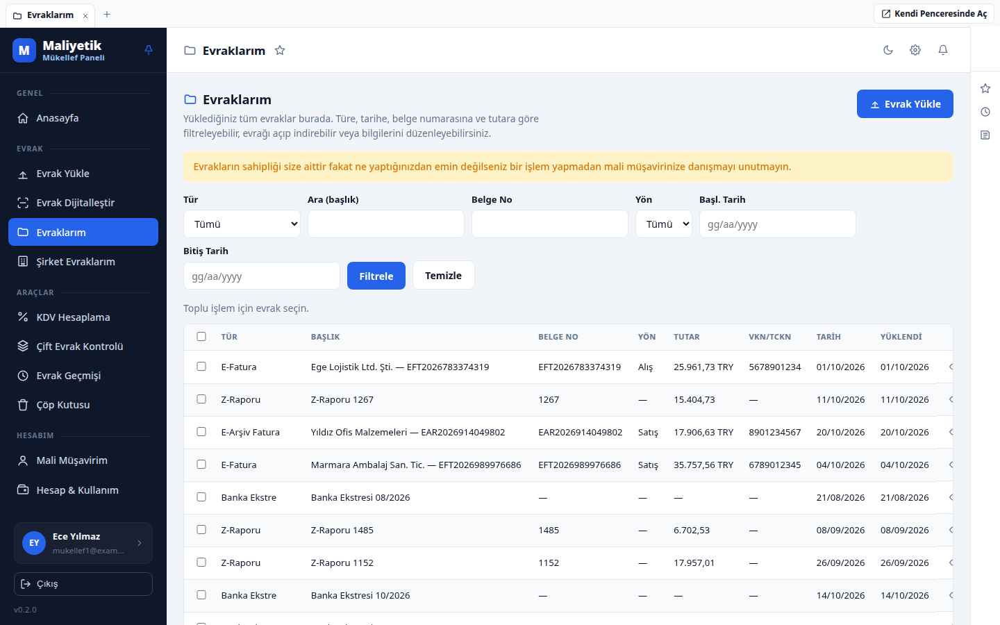
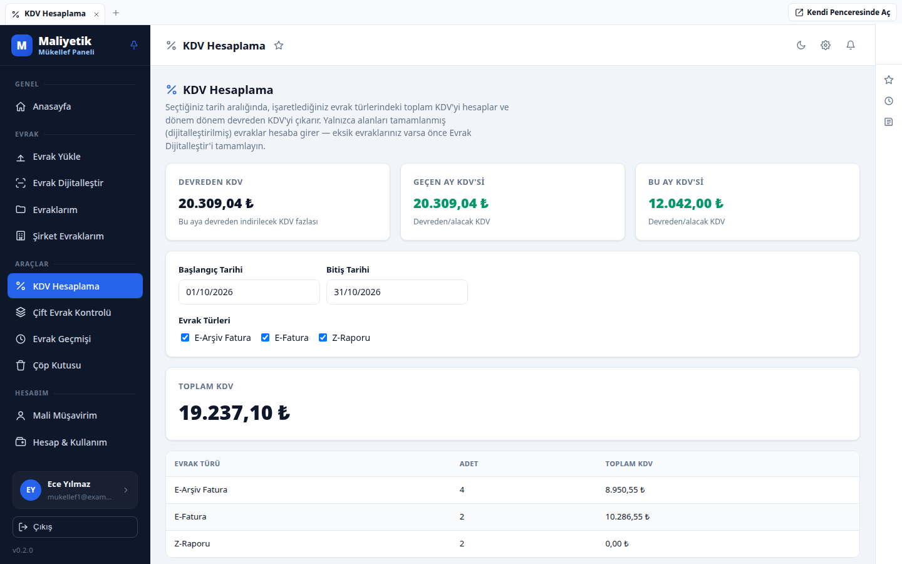
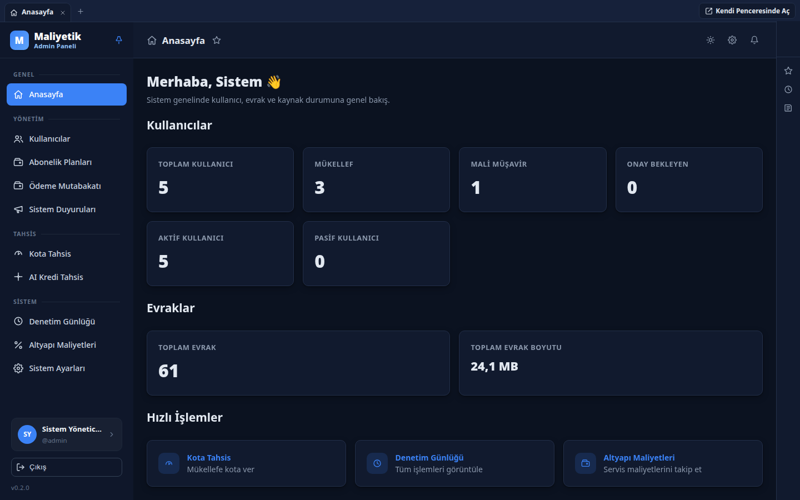
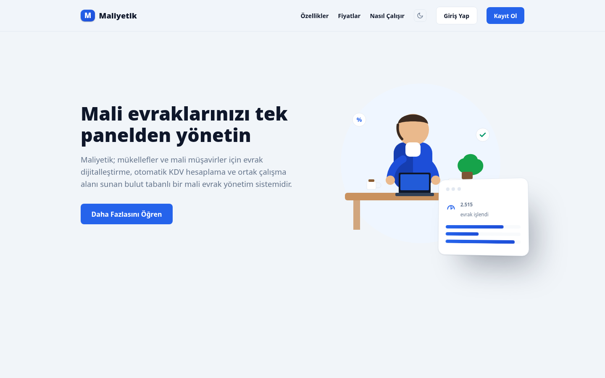
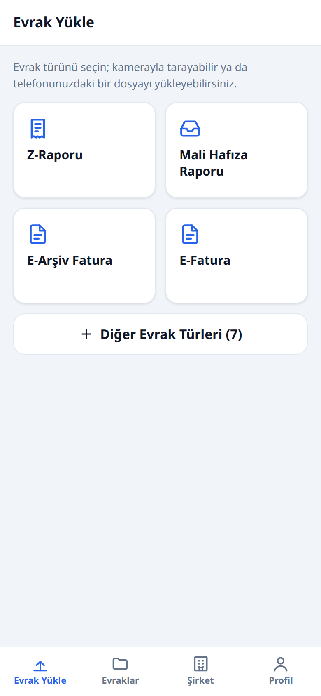

# Maliyetik

[English](README.md) · **Türkçe**

Mükellefler ve mali müşavirler için mali evrak yönetim sistemi. Faturalar, Z-raporları,
makbuzlar, banka ekstreleri ve şirket evrakları türe özel alanlarla arşivlenir; mükellef ve
müşavir aynı evrak arşivi üzerinde birlikte çalışır.



> **Başlamadan önce küçük bir not:** Maliyetik en başta kendi kullanımım için tasarlandı; başkalarının da işine yarayabilir diye paylaşıyorum. Kendi ihtiyaçlarım ve tercihlerim doğrultusunda şekillendiği için herkese hitap etmeyebilir. Öneri ve geri bildirimlerinizi memnuniyetle karşılarım.

## Özellikler

- **Üç rol:** Admin, Mükellef ve Mali Müşavir. Müşavir yalnızca kendisine aktif yetki vermiş
  mükelleflerin evraklarına erişir; bir mükellefin aynı anda en fazla bir aktif müşaviri olur.
- **Evrak arşivi:** E-Fatura, E-Arşiv, Z-Raporu, tahsilat/tediye makbuzu, çek, banka ekstresi
  ve şirket evrakları (imza sirküsü, vergi levhası…). Her türün kendi alan şeması vardır;
  türe, tarihe, belge numarasına, tutara ve VKN'ye göre filtreleme.
- **Evrak dijitalleştirme:** Yüklenen evrakın alanları elle ya da isteğe bağlı olarak Gemini
  ile otomatik doldurulur (çoklu faturalı PDF ayırma, Mali Hafıza raporundan Z-raporu üretme).
- **KDV hesaplama:** Seçilen dönemde evrak türlerine göre toplam ve devreden KDV.
- **Luca entegrasyonu:** Luca zip arşivinden e-Fatura/e-Arşiv içe aktarma, Z-raporu fişlerini
  Luca'ya dışa aktarma.
- **Çift evrak kontrolü, evrak geçmişi, çöp kutusu.**
- **Mobil uygulama (PWA):** `/app/` altında kamerayla belge tarama ve yükleme.
- **Kota ve abonelik:** Evrak kotası, yapay zeka kredisi, abonelik planları; ödeme sağlayıcısı
  olarak `mock`, iyzico veya Shopier.
- **Yönetim:** Kullanıcı onayı, kota/kredi tahsisi, duyurular, denetim günlüğü, bakım modu,
  altyapı maliyet defteri.
- **Herkese açık araçlar:** KDV, kredi, desi, stopaj ve gelir vergisi hesaplayıcıları.
- **Yasal metin şablonları:** KVKK aydınlatma, gizlilik, kullanım koşulları, mesafeli satış
  vb. (`frontend/src/legal/`). Şirket bilgileri yer tutucu olarak gelir; doldurulmadan
  yasal sayfalarda "taslak" şeridi görünür.

## Ekran görüntüleri

| Mükellef — Evraklarım | Mükellef — KDV Hesaplama |
|---|---|
|  |  |

| Admin paneli (koyu tema) | Tanıtım sayfası |
|---|---|
|  |  |



Görüntülerdeki tüm kişi, firma ve evrak verileri örnektir.

## Mimari

| Servis | Teknoloji | Açıklama |
|---|---|---|
| `frontend` | React 18 (Vite) + Nginx | Masaüstü panel (`/`) ve mobil PWA (`/app/`); `/api` isteklerini backend'e iletir |
| `backend` | NestJS 10 + TypeScript, TypeORM | REST API (`/api/v1`), zamanlanmış işler, PDF üretimi (Chromium) |
| `mysql` | MySQL 8.4 | Şema `docker/mysql/init` ile ilk açılışta yüklenir |
| `redis` | Redis 7 | Önbellek ve BullMQ kuyruğu |
| — | Google Cloud Storage | Evrak dosyaları (imzalı URL ile servis edilir) |

- Yalnızca `frontend` dışarıya port açar; MySQL, Redis ve backend dahili ağdadır.
- Backend katmanları: `controller → service → repository (TypeORM) → entity`.
- Kimlik doğrulama: JWT access + refresh (rotasyonlu, hash'li saklanır).
- Evrak meta verisi `documents.metadata` JSON kolonunda tutulur; kanonik alanlar
  (`meta_amount`, `meta_doc_no`, `meta_tax_id`…) indeksli `GENERATED STORED` kolonlara çıkar.

```
maliyetik/
├─ docker-compose.yml
├─ docker/mysql/init/   # 01_schema.sql, 02_seed.sql (evrak türleri, kota paketleri)
├─ backend/             # NestJS API — src/{config,common,database,infrastructure,modules,shared}
├─ frontend/            # React SPA + mobil PWA
├─ scripts/ortam.sh     # isteğe bağlı: geliştirme/üretim yığınlarını yan yana yönetme
└─ docs/
```

## Kurulum

Gereksinimler: Docker ve Docker Compose v2. Evrak yükleme için bir Google Cloud Storage
kovası ve servis hesabı gerekir.

### Docker Compose

```bash
# 0) Depoyu indirin
git clone https://github.com/lckt0/maliyetik.git
cd maliyetik

# 1) Ortam değişkenleri
cp .env.example .env
# .env içindeki parolaları, JWT anahtarlarını ve GCS bilgilerini doldurun.
#   openssl rand -hex 32                 # JWT anahtarı üretmek için
#   base64 -w0 service-account.json      # GCS_CREDENTIALS_B64 için

# 2) Derleyip başlatın
docker compose up -d --build

# 3) Veritabanı migration'larını uygulayın
docker compose --profile tools run --rm backend-migrate

# 4) İlk admin kullanıcısını oluşturun (ADMIN_EMAIL / ADMIN_PASSWORD)
docker compose exec backend npm run seed:prod
```

Uygulama `http://localhost:3340` adresinde açılır (`FRONTEND_HOST_PORT`). Port varsayılan
olarak yalnızca `127.0.0.1`'e bağlanır; üretimde önüne TLS sonlandıran bir ters vekil
(Nginx, Caddy, Traefik…) koyun ve `APP_URL` / `CORS_ORIGINS` değerlerini dış adrese göre
ayarlayın. Mobil uygulamanın kamera taraması yalnızca HTTPS üzerinde çalışır.

Kayıt sırasında doğrulama e-postası gönderildiği için çalışan bir SMTP sunucusu gerekir.
Yeni hesaplar admin panelinden onaylanabilir.

### Güncelleme

```bash
git pull
docker compose up -d --build
docker compose --profile tools run --rm backend-migrate
```

### Docker olmadan geliştirme

MySQL 8 ve Redis 7'nin çalıştığını varsayarak:

```bash
# Backend
cd backend
npm ci
# DB_HOST, DB_PORT, REDIS_HOST ... değişkenlerini ortamda tanımlayın (bkz. .env.example)
npm run migration:run
npm run seed
npm run start:dev          # http://localhost:3000/api/v1

# Frontend
cd frontend
npm ci
npm run dev                # http://localhost:5173
```

Vite geliştirme sunucusu `/api` isteklerini kendiliğinden iletmez; `VITE_API_BASE_URL`
değişkenini backend adresine (`http://localhost:3000/api/v1`) ayarlayın ve `CORS_ORIGINS`'e
`http://localhost:5173` ekleyin.

Aynı makinede ayrı bir geliştirme yığını ve üretim yığını çalıştırmak için
[docs/ortam-yonetimi.md](docs/ortam-yonetimi.md) dosyasına bakın.

## Ortam değişkenleri

Tam liste ve açıklamalar [.env.example](.env.example) içindedir.

| Değişken | Zorunlu | Açıklama |
|---|---|---|
| `APP_URL` | evet | Uygulamanın dış adresi (e-posta bağlantıları, dosya adresleri) |
| `CORS_ORIGINS` | — | Virgülle ayrılmış izinli origin listesi |
| `FRONTEND_BIND`, `FRONTEND_HOST_PORT` | — | Frontend'in host'ta dinleyeceği adres/port (vars. `127.0.0.1:3340`) |
| `VITE_API_BASE_URL` | — | API kökü; frontend aynı origin'den ilettiği için vars. `/api/v1` |
| `VITE_SITE_URL` | — | Canonical/og etiketleri ve site haritası adresi (boşsa `APP_URL`) |
| `VITE_SUPPORT_EMAIL` | — | Abonelik sayfasındaki destek adresi (boşsa `destek@<alan-adı>`) |
| `DB_ROOT_PASSWORD`, `DB_DATABASE`, `DB_USERNAME`, `DB_PASSWORD` | evet | MySQL |
| `REDIS_PASSWORD` | evet | Redis parolası |
| `SMTP_HOST`, `SMTP_PORT`, `SMTP_USER`, `SMTP_PASS`, `SMTP_FROM` | evet | E-posta doğrulama ve şifre sıfırlama |
| `JWT_ACCESS_SECRET`, `JWT_REFRESH_SECRET` | evet | En az 16 karakter; `openssl rand -hex 32` |
| `JWT_ACCESS_TTL`, `JWT_REFRESH_TTL` | — | Saniye (vars. 900 / 1209600) |
| `GCS_PROJECT_ID`, `GCS_BUCKET`, `GCS_CREDENTIALS_B64` | evet | Evrak dosyalarının saklandığı Google Cloud Storage kovası |
| `MAX_UPLOAD_MB` | — | Yükleme sınırı (vars. 50) |
| `ADMIN_EMAIL`, `ADMIN_PASSWORD` | ilk kurulum | `npm run seed:prod` ile oluşturulan ilk admin |
| `GEMINI_API_KEY` | — | Yapay zeka özellikleri için Google Gemini anahtarı; boşsa bu özellikler kapalıdır |
| `GEMINI_MODEL_CHEAP`, `GEMINI_MODEL_LIGHT`, `GEMINI_MODEL_ADVANCED`, `GEMINI_CONFIDENCE_THRESHOLD` | — | Model seçimi ve güven eşiği |
| `PAYMENT_PROVIDER` | — | `mock` (vars., gerçek tahsilat yok), `iyzico` veya `shopier` |
| `IYZICO_API_KEY`, `IYZICO_SECRET_KEY` | — | iyzico anahtarları |
| `SHOPIER_API_KEY`, `SHOPIER_API_SECRET`, `SHOPIER_WEBSITE_INDEX` | — | Shopier anahtarları |
| `ENFORCE_SEAT_LIMITS` | — | Müşavir paketlerindeki mükellef sınırı uygulansın mı (vars. `false`) |
| `GCP_BILLING_*`, `BREVO_API_KEY` | — | Admin > Altyapı Maliyetleri sayfası için canlı veri |
| `TZ` | — | Saat dilimi (vars. `Europe/Istanbul`) |

### Yapay zeka özellikleri (isteğe bağlı)

`GEMINI_API_KEY` verildiğinde evrak dijitalleştirme (alanların görüntüden/PDF'ten okunması),
çoklu faturalı PDF ayırma, Mali Hafıza raporu okuma ve doğal dille arama/özet özellikleri
açılır. Anahtar yalnızca backend'de kullanılır, istemciye gönderilmez. Özellikler ayrıca
admin panelinden rol bazında kapatılabilir; dijitalleştirme kullanıcı başına AI kredisi tüketir.

## Veritabanı

- Şema: [docker/mysql/init/01_schema.sql](docker/mysql/init/01_schema.sql), referans verileri:
  [02_seed.sql](docker/mysql/init/02_seed.sql). Bu dosyalar yalnızca veritabanı boşken, ilk
  açılışta yüklenir; sonraki şema değişiklikleri `backend/src/database/migrations` altındaki
  TypeORM migration'larıyla gelir.
- TypeORM `synchronize` kapalıdır; şema yalnızca SQL/migration ile değişir.
- Yedek almak için: `docker compose exec -T mysql sh -c 'exec mysqldump -uroot -p"$MYSQL_ROOT_PASSWORD" --single-transaction "$MYSQL_DATABASE"' | gzip > yedek.sql.gz`

## Öne çıkan API uçları (`/api/v1`)

| Metod | Uç | Rol | Açıklama |
|---|---|---|---|
| POST | `/auth/login` `/auth/refresh` `/auth/logout` `/auth/register` | — | Kimlik |
| GET  | `/document-types?category=` | tümü | Türler + dinamik form şeması |
| POST | `/documents` (multipart) | mükellef/müşavir | Evrak yükle (kota düşer) |
| GET  | `/documents?documentTypeId=&dateFrom=&amountMin=&taxId=` | tümü | Türe özel listeleme |
| GET/DELETE | `/documents/:id` | tümü | Detay (imzalı URL) / sil |
| GET/POST/DELETE | `/company-documents` | mükellef/müşavir | Şirket evrakları (kota tüketmez) |
| POST | `/authorizations/request` `/:id/accept` `/:id/revoke` | mükellef/müşavir | Müşavir yetkilendirme |
| GET  | `/quota/me` | mükellef | Kota özeti |
| POST | `/admin/quota/grant` | admin | Manuel kota tahsisi |
| GET  | `/health` | — | Sağlık ve sürüm bilgisi |

## Kaldırma

Komutları depo dizininde çalıştırın.

```bash
docker compose down                  # konteynerleri ve ağı kaldırır, veriyi korur
docker compose down -v               # veritabanı ve Redis hacimlerini de siler (geri alınamaz)
docker compose down -v --rmi local   # ayrıca derlenen backend/frontend imajlarını da siler
```

Önünde bir ters vekil kullandıysanız Maliyetik için eklediğiniz site/sunucu tanımını oradan
kaldırın. Her şeyi sildikten sonra depo dizinini (`.env` dosyasıyla birlikte) silebilirsiniz.

Verileri de silmek isterseniz (isteğe bağlı): `-v` veritabanını ve Redis'i siler; GCS
kovasındaki evrak dosyaları ise ayrıca, Google Cloud Console'dan ya da
`gcloud storage rm "gs://<kova-adı>/**"` ile silinmelidir.

## Lisans

[MIT](LICENSE)
